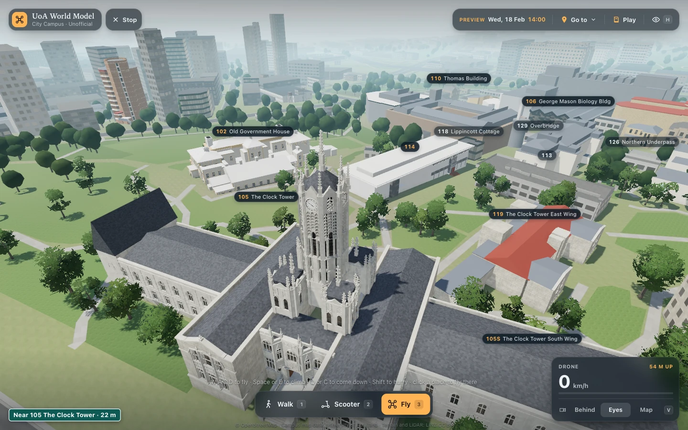
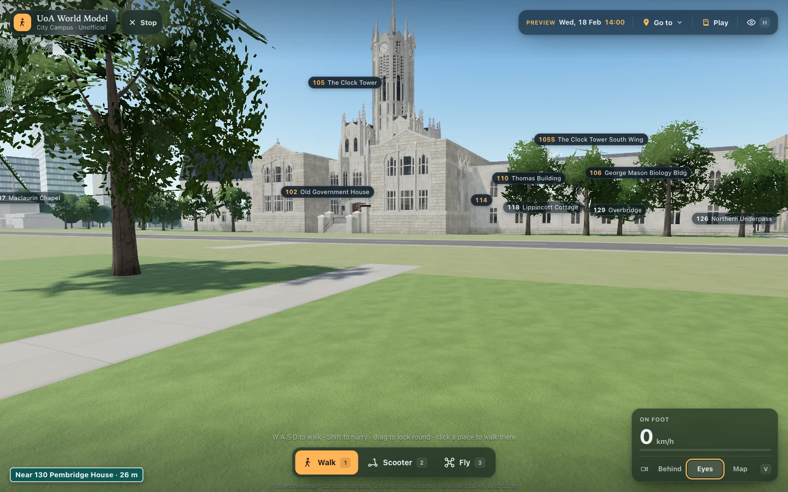
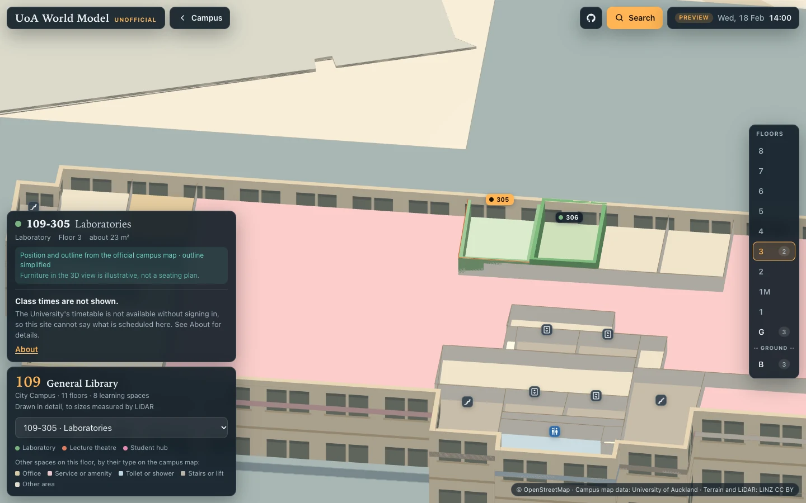

# UoA World Model · 奥克兰大学三维校园

在浏览器里走过 City Campus 的钟楼，驾驶无人机越过屋顶，再打开教学楼的楼层剖面。这个本地预览版默认加载奥克兰大学，随仓库提供运行所需的校园数据，不需要提供照片或配置地图 API 密钥。

这是基于 **Campus World Model** 的非官方开源分支。原项目由学生制作，页面使用项目自己的名称、图标和配色。 [上游项目与英文文档](https://github.com/pengqianhan/campus-world-model/tree/40d0dd3a3f945e13dfaa39355f6be22b62a736fe)

## 演示视频

[](https://github.com/TomHaoZi/uoa-world-model/releases/tag/v0.1.0-uoa-preview)

视频录自本地浏览器，时长 44 秒，分辨率 1440 × 900，带中文字幕。 [GitHub Release](https://github.com/TomHaoZi/uoa-world-model/releases/tag/v0.1.0-uoa-preview) · [下载 MP4](https://github.com/TomHaoZi/uoa-world-model/releases/download/v0.1.0-uoa-preview/uoa-campus-tour.mp4)

- **00:00** 从 City Campus 总览进入第一人称步行，朝钟楼走。
- **00:14** 使用 **Fly** 起飞，俯瞰钟楼屋顶和周边建筑。
- **00:34** 切换 General Library 的楼层，查看 109-305 实验室。

## 校园里可以做什么

### 在地面探索



点 **Take a walk** 从钟楼附近出发。**Behind** 适合边走边观察角色周围，**Eyes** 会把镜头移到第一人称，**Map** 可以从上方查看位置。用 `WASD` 或方向键移动，按住 `Shift` 跑步，拖动场景转头。手机和平板可用画面上的摇杆和触控按钮。

### 飞过建筑

在校园总览点 **Fly** 可直接进入第一人称无人机视角。步行途中也可点 **Fly** 或按 `3` 起飞。用 `E` 或空格上升、`Q` 或 `C` 下降，按 `1` 落地。可以从低处看钟楼的尖顶和窗格，也可以升高观察 Princes Street、Albert Park 与校园建筑之间的位置。飞行最高为距地面 120 米。

### 查看楼层和房间



点击建筑进入楼层剖面，切换楼层后可选择房间。在 **Search** 中输入楼名、建筑编号或房号可直接定位。例如 `109-305` 对应 General Library 三楼的一间实验室，`303-G23` 位于 Science Centre。

## 本地启动

使用项目要求的 Node.js 22.18 或更新版本。选用 **Node 22 LTS** 可以同时满足锁定版本的测试依赖。浏览器需要支持 WebGL 2。

```bash
git clone https://github.com/TomHaoZi/uoa-world-model.git
cd uoa-world-model
npm ci
npm run dev
```

在浏览器地址栏打开下列任一地址。运行中的终端会显示 Vite 的本地地址。

- [校园总览](http://localhost:5273/campus-world-model/)
- [日间第一人称步行](http://localhost:5273/campus-world-model/?walk=1&view=eyes&light=day)
- [日间第一人称飞行](http://localhost:5273/campus-world-model/?walk=1&view=eyes&ride=fly&light=day)
- [总图书馆三楼 109-305](http://localhost:5273/campus-world-model/?building=109&floor=3&room=109-305)

`npm run build` 将静态站点构建到 `dist/`。`npm run typecheck` 检查类型，`npm test` 运行单元测试。项目使用 Three.js 渲染地形和建筑，Preact 负责界面，Vite 提供开发和构建环境。 [开发说明](docs/development.md) · [浏览器与 Walker CLI 操作](docs/walker.md)

## 数据覆盖与细节

仓库随附的奥克兰大学快照收录 **194 栋建筑、786 个学习空间、4,573 个已索引房间和 14,840 个楼层平面图形**。覆盖 City、Grafton、Newmarket、Tai Tokerau、Tai Tonga、Ardmore、Leigh 和 Waiheke。 [快照元数据](public/data/uoa/meta.json)

钟楼、Old Government House、Science Centre 等地标有按公开测量数据制作的精细模型。其他建筑的立面细节、楼层和高度会随来源覆盖变化，界面会标注估算值。楼层剖面来自公开平面数据，门的位置及需要登录的课堂课表未纳入。截图和视频均为三维场景的渲染画面。 [地标清单](docs/landmarks.md) · [数据限制](docs/limitations.md)

本预览版使用内置天况，保留日夜、时间预览和季节效果。校园模型沿用上游数据快照，并保留地图上的来源标注。

## What's new

本预览版在校园总览加入 **Fly** 快捷入口，打开时即可驾驶第一人称无人机。**Eyes** 按钮增加了第一人称提示。 [更新记录](CHANGELOG.md)

## Data sources and licences

- **奥克兰大学公开校园地图与校历** 提供建筑、楼层、房间位置及学期日期，相关版权归奥克兰大学。 [上游数据说明](docs/data-sources.md)
- **OpenStreetMap contributors** 提供周边街道、绿地和建筑轮廓，适用 ODbL 1.0。 [OpenStreetMap 版权说明](https://www.openstreetmap.org/copyright)
- **Land Information New Zealand（LINZ）** 的地形数据适用 CC BY 3.0 NZ。地标测量使用的 Auckland 2024 LiDAR 适用 CC BY 4.0。 [地形来源](https://data.linz.govt.nz/layer/51768-nz-8m-digital-elevation-model-2012/) · [LiDAR 来源](https://doi.org/10.5069/G9HH6H8T)
- **Quaternius** 的 Animated Human 角色资源适用 CC0 1.0。 [角色来源](https://opengameart.org/content/animated-human-low-poly)

源代码采用 [MIT License](LICENSE)。地图数据各自适用其来源条款，详见 [NOTICE](NOTICE)。
